  

## About

Second year B.Tech student in AI and Data Science at DJSCE, Mumbai, on the Honours track in Business Intelligence. I work across AI engineering, cybersecurity and full stack systems.

I use AI assisted development as a main tool. It gets things shipped sooner, and it only works if I understand the code well enough to check it.

I have entered a handful of hackathons, spent a summer on a housing society maintenance system as a web developer intern, and I am now an AI and ML mentee at DJS InfoMatrix. Cybersecurity is a serious second track: Kali Linux, log analysis, and a lot of reading.

## Now

| | |
|---|---|
| Mentee | AI and ML, DJS InfoMatrix, since August 2026 |
| Studying | Neetcode 150 in Java, alongside Sem 3 coursework |
| Looking for | Winter 2026 internships |

## Selected work

| Project | What it is | Links |
|---|---|---|
| **CivicFix** | AI civic issue reporting. Clusters duplicate reports, scores priority by hazard and age, and checks repairs with before and after photos using Gemini Vision. Ignite 8.0, September 2026. Built with Tejas Kute, Shreya Desai and Miti Moradiya. | [Code](https://github.com/WisdomKingAR/CivicFix) · [Live](https://civic-fix-zeta-five.vercel.app/) |
| **NexusChat** | Real time messaging over WebSockets with MongoDB, JWT auth and rate limiting. ACM ReCode. Built with Tejas Kute and Miti Moradiya. | [Code](https://github.com/WisdomKingAR/NexusChat) |
| **CryoNex** | Cold chain pharma logistics with shipment tracking, telemetry monitoring and a compliance vault. Cyber Cypher 5.0, Round 2 finalist. Built with Tejas Kute and Shreya Desai. | [Code](https://github.com/WisdomKingAR/CryoNex) |
| **FlowState** | A focus first workspace that puts inbox, calendar and dashboard in one place. Cyber Cypher 5.0, Round 1. Built with Tejas Kute and Shreya Desai. | [Code](https://github.com/WisdomKingAR/FlowState) |

More on the [portfolio](https://aaryan-raorane-portfolio.vercel.app/).

## Stack

| | |
|---|---|
| **Languages** | Python, Java, C, JavaScript, SQL |
| **AI and data** | scikit-learn, Pandas, NumPy, Matplotlib, Seaborn, prompt engineering, generative AI tools |
| **Web** | React, Node.js, FastAPI, Tailwind CSS, MongoDB, MySQL |
| **Security** | Kali Linux, Linux, cybersecurity tools |
| **Workflow** | Git, GitHub, Figma |

## Recognition

2nd place, DevHub Code Quest (May 2026). Round 2 finalist, Cyber Cypher 5.0 (March 2026). Certificates in Python (Kaggle), Java (HackerRank), Linux for Developers and Git (Coursera), and SQL (OneRoadmap). The full list is on [LinkedIn](https://linkedin.com/in/aaryanraorane).

Sem 1 SGPA 9.74, Sem 2 SGPA 9.70.

## Contribution activity

This is generated daily from my real GitHub contributions.

  <picture>
    <source media="(prefers-color-scheme: dark)" srcset="https://raw.githubusercontent.com/WisdomKingAR/WisdomKingAR/output/snake-dark.svg" />
    <source media="(prefers-color-scheme: light)" srcset="https://raw.githubusercontent.com/WisdomKingAR/WisdomKingAR/output/snake.svg" />
    
  </picture>

## Find me

  

